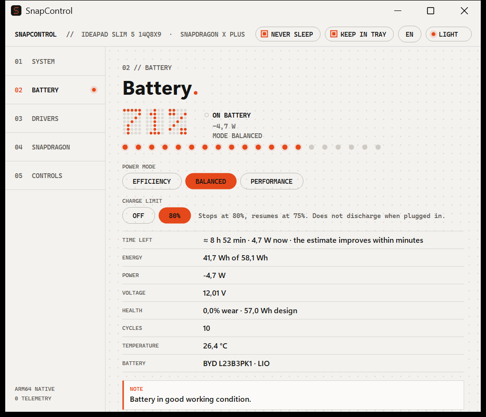
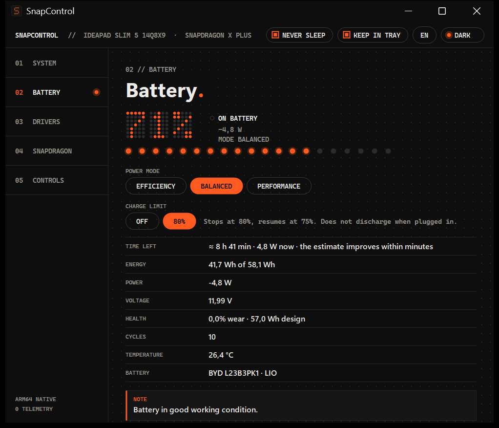

# SnapControl

Version 1.1.0

A lightweight control panel for the **Lenovo IdeaPad Slim 5 14Q8X9 (83HL)** with **Snapdragon X Plus**, built as an alternative to Lenovo Vantage: native ARM64, no telemetry, a single executable of about 187 KB.

Author: **mich-de** — [github.com/mich-de/snapcontrol](https://github.com/mich-de/snapcontrol)





## What it does

- **System** — model, UEFI firmware, processor, memory, Windows build, architecture.
- **Battery and energy** — charge (dot-matrix digits), power, voltage, wear against design capacity, cycles, temperature; switching the Windows power mode (`EFFICIENCY` / `BALANCED` / `PERFORMANCE`), which is the recommended control for the Oryon cores and the NPU on Snapdragon X; usage tips.
- **Charge limit** — `OFF` / `50%` / `80%` / `85%` / `90%` / `95%` buttons on the Battery page. A scheduled task running as SYSTEM (`SnapControl Limite carica`, started at boot, no network use) stops charging at the chosen level and resumes it 5% below (at 75% for the 80% limit), checking every 30 seconds. It works only while Windows is running and does not hold the limit while the PC is off. Turning it on, changing the level or turning it off asks for administrator permission, and turning it on requires SnapControl to be installed in Program Files.
- **Estimated battery life** — time left (or time to full charge) calculated from the energy actually used over the last 10 minutes, not from the instantaneous value, which fluctuates. It starts over when the charger is plugged in or unplugged or when the power mode changes.
- **Notification area** — with the `KEEP IN TRAY` check in the top bar, SnapControl stays in the notification area (icon with the percentage, tooltip with the battery life, menu with the power modes), the X hides the window instead of closing it, and the app starts with Windows (`--tray`). Clearing the check also removes the automatic start.
- **Never sleep** — `NEVER SLEEP` check in the top bar: sleep and hibernation on idle are turned off, the network stays connected in modern standby (for example with the lid closed), and the Wi-Fi adapter runs at maximum performance. Clearing the check restores the previous values, saved when it was turned on.
- **Drivers and BIOS** — list of installed third-party drivers, sortable by clicking the `DEVICE`, `PROVIDER`, `VERSION`, `DATE` and `AGE` column headers. `CHECK FOR UPDATES` searches three sources:
  - **Windows Update**, where Lenovo publishes the certified drivers for the 83HL.
  - The **pcsupport.lenovo.com download API**: the BIOS is shown only if it is newer than the installed one, with a link to the Lenovo package page.
  - The **Microsoft Update Catalog**: newer ARM64 drivers, including those published for other brands with the same hardware. It searches by device name and by PCI/USB ID, and Qualcomm devices with ACPI IDs are also searched as `QCOMxxxx`. A package is accepted only if it lists the device and is not older than the installed driver. These drivers are installed with pnputil and are not preselected. Before installing, the driver in use is exported to `%ProgramData%\SnapControl\backup`; the package is removed if Windows does not adopt it, and uninstalled if the device fails. Catalog pages are cached in `%LocalAppData%\SnapControl\catalog`, searches for 6 hours.

  Install one at a time or in bulk (`INSTALL SELECTED`, `INSTALL ALL`), with an administrator prompt only at install time. `LENOVO 83HL PAGE` opens the Lenovo driver page for the 83HL.

  A BIOS row is always visible on this page: `CHECK BIOS` asks Lenovo for the latest version and shows it next to the installed one. `DOWNLOAD` then saves that package, and `INSTALL` appears only when it is newer (same version prefix, higher number). The package is saved in `%LocalAppData%\SnapControl\bios` and accepted only if its SHA-256 matches the Lenovo API and its Authenticode signature is valid, not revoked and from Lenovo. `INSTALL` asks for confirmation, requires the charger and at least 30% battery, copies the package to a folder only administrators can write to, checks that copy and opens Lenovo's own installer window; there is no silent flash. BIOS settings return to defaults, the PC restarts, and Lenovo says not to go back to an earlier BIOS.

  Each update has a `PACKAGE` link (Lenovo page or Microsoft catalog search; for Windows Update drivers it searches the catalog by title, so the package may not be listed there) and a `FLAG` button that marks it as possibly incompatible. A flagged update is saved on this PC (`HKCU\Software\SnapControl`), and it cannot be selected or installed from SnapControl until you press `UNFLAG`. Flagged updates also get an `ISSUE` link, which opens a prefilled GitHub issue with the driver, source, machine type and versions: nothing is sent until you submit it on GitHub.
- **Snapdragon** — live load (every 2 s, only while the page is open) of the Oryon CPU (total, frequency, per core), Adreno GPU (3D, compute, video, shared memory) and Hexagon NPU; versions of the Qualcomm drivers (GPU, NPU, Wi-Fi, Bluetooth, DSP, battery, thermal).
- **Controls** — three views:
  - `CPU AND SCREEN`: maximum CPU state and boost, separately for battery and AC (active power plan), brightness, screen refresh rate (48/60 Hz on this panel).
  - `POWER`: screen off, sleep, hibernate (if available), battery saver threshold, lid action and power button action, on AC and on battery, in the active power plan. While `NEVER SLEEP` is on, sleep and hibernate are read-only. "Never" for sleep on both AC and battery is set with the `NEVER SLEEP` check.
  - `APP USAGE`: each app's share of its own energy, excluding screen and losses, over the last 24 hours on battery. The data comes from `powercfg /srumutil` and is a Windows estimate: the figures are relative shares, not watts. It runs only when you press `REFRESH`, which asks for administrator permission, and the temporary file is deleted after reading.
- **UAC** — the System page shows whether Windows asks for permission on this PC. Admin actions always go through the Windows prompt; there is no way around it for one app that does not create a privilege escalation path, so SnapControl offers none. Driver installs also ask for SnapControl's own confirmation.
- **Two languages** — the window is in English (default) or Italian, switched with the `EN`/`IT` button in the top bar. The command-line output and the charge-limit log are in Italian only.

## Requirements

**Nothing has to be changed in Windows and no library has to be installed for normal use.** No .NET download, Visual C++ runtime, kernel driver, test signing, Developer Mode or Secure Boot change.

- **PC**: Lenovo IdeaPad Slim 5 14Q8X9 (83HL) is the only model tested. On other PCs the Lenovo, BIOS and charge-limit functions may not work.
- **Windows**: Windows 11 ARM64, tested on build 26300. Native ARM64 needs 24H2 or later; on earlier versions the manifest setting is ignored and the app starts under x64 emulation (not tested).
- **Runtime**: .NET Framework 4.8.1, already included in Windows 11 22H2 and later.
- **Installer warning**: the installer is not code-signed, so SmartScreen may warn on a downloaded copy. Check its SHA-256 against the release page, then choose *More info › Run anyway*.

Some functions need more:

| Function | Needs |
|---|---|
| Charge limit | Administrator rights; SnapControl installed in Program Files; Qualcomm battery driver (tested: `qcbattminiclass8380` 1.0.4458.2600); charger connected. |
| Driver search and install | Internet; Windows Update service (`wuauserv`) not disabled; administrator rights to install. |
| BIOS | Internet; administrator rights; charger and at least 30% battery. If BitLocker or device encryption is on, keep the recovery key and suspend protection first: SnapControl does not do this. |
| `APP USAGE` | Administrator rights; `DPS` service running and autologger `DiagLog` enabled (`Start` = 1 in `HKLM\SYSTEM\CurrentControlSet\Control\WMI\Autologger\DiagLog`). These are on by default, but privacy or debloat tools may turn them off: without them `powercfg /srumutil` has no data. Windows also needs time on battery to collect it. |

**UAC** does not need changing: SnapControl uses the normal Windows prompt. A standard account will be asked for an administrator password. If `ConsentPromptBehaviorAdmin` is `0`, any program can get admin rights without asking; the recommended value is `5`.

## Principles

- **Native ARM64** — runs on the .NET Framework 4.8.1 ARM64 runtime included in Windows 11 (the manifest declares `supportedArchitectures`; without it Windows would start the app under x64 emulation).
- **No telemetry, no automatic network use** — the only connections are the update search (Windows Update, Lenovo API, Microsoft catalog) and the downloads for the updates you choose to install. The search starts only when you press the button.
- **Lightweight** — no background service unless the charge limit is on, no continuous animation (GPU idle), about 25 MB of private RAM.
- **"Technical Minimal" style** — paper, thin lines, dot grid, orange LED, numbered mono labels; Light / Dark / Cactus themes based on [technical-minimal-web_2.0](https://github.com/mich-de/technical-minimal-web_2.0). System fonts: Cascadia Mono and Segoe UI Variable.

## Known limitations

- **Rapid charge**: the Lenovo firmware does not expose it on this model, so it is not available.
- **Charge limit**: the Lenovo firmware does not expose it, so SnapControl uses the Qualcomm battery driver. Charging stops at the chosen level, but the battery does not discharge while the charger is connected: to go from 100% down to the limit you have to unplug the cable.

## Build

Nothing needs to be installed: the C# compiler is already in Windows.

```cmd
build.cmd
```

This produces `bin\SnapControl.exe` (with `SnapControl.exe.config` next to it) and the installer `bin\SnapControl-Setup.exe`, which contains the app.

## Install

Download `SnapControl-Setup.exe` from [Releases](https://github.com/mich-de/snapcontrol/releases/latest). It asks for administrator permission, installs to `C:\Program Files\SnapControl`, creates shortcuts on the desktop and in the Start menu, and appears in *Settings › Installed apps*, where it can be uninstalled (this also removes the automatic start and the charge-limit task, and lets charging resume). Running it again updates the existing installation, closing the app first if it is open. Options: `/quiet` (no windows), `uninstall.exe /uninstall`.

The icon (`src\app.ico`) is regenerated with `tools\MakeIcon.cs`.

Options without the interface: `SnapControl.exe --report report.txt` (diagnostics, in the language chosen in the window), `--power-label` (labels from stdin), `--power-settings <file>` (current values), `--power-set <name> <ca|cc> <value>`.

## Structure

| File | Contents |
|---|---|
| `src/SnapControl.cs` | data (battery, system, drivers, Windows Update, Lenovo API, Snapdragon counters) and window |
| `src/Ui.cs` | themes, dot matrix, title bar |
| `src/app.manifest` | per-monitor DPI, `asInvoker` execution, native ARM64 |
| `src/Setup.cs`, `src/setup.manifest` | installer / uninstaller |
| `src/app.ico` | icon (generated by `tools/MakeIcon.cs`) |
| `build.cmd` | build with `FrameworkArm64\csc.exe` |
